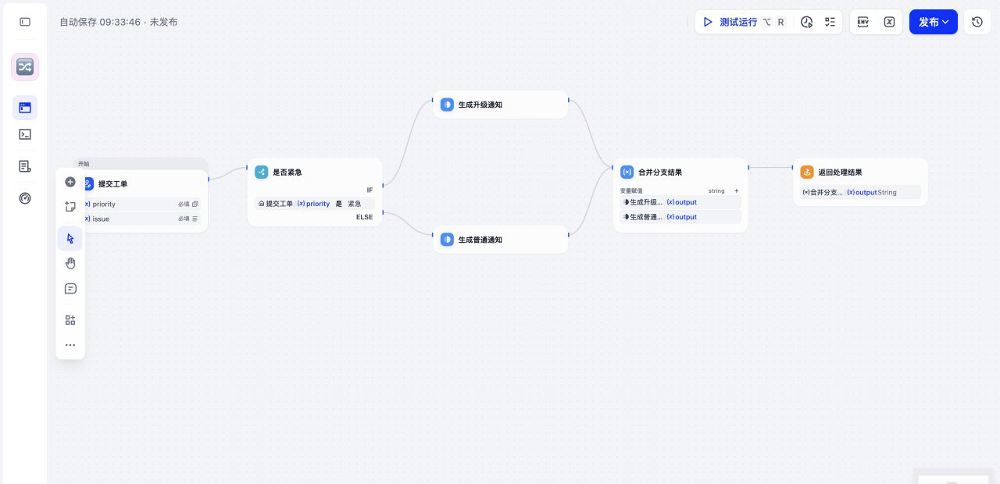
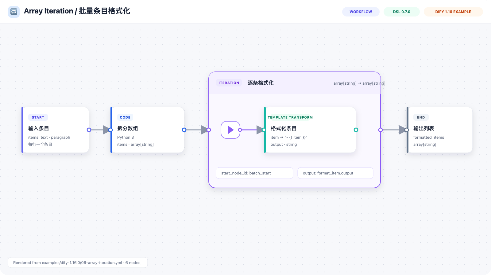
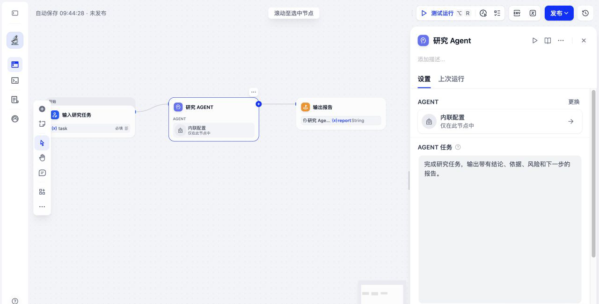

# Dify Workflow DSL Skill

> Create, repair, review, migrate, and validate Dify App DSL with an AI coding
> agent.

[中文说明](./README_CN.md) · [4 Dify 1.18 examples](./examples/dify-1.18.0) ·
[10 Dify 1.16 examples](./examples/dify-1.16.0) ·
[1.18 evaluation report](./references/dify-1.18-evaluation.md)

> **Targets Dify 1.18 by default, with Dify 1.15/1.16 compatibility.** Both
> 1.16 and 1.18 use DSL `0.7.0`; select the Dify release with `--dify-version`.
> [1.18 compatibility](./references/dify-1.18-target.md) ·
> [Current verification](./references/dify-1.18-evaluation.md)

## What's New — 2026-10-30

- **Dify 1.18 support with legacy profiles.** Select 1.18, 1.16, or 1.15 with
  `--dify-version`; DSL 0.7.0 defaults to 1.18 and DSL 0.6.0 to 1.15.
- **Current Agent and knowledge schemas.** Validate Agent system outputs and
  routes, workspace skills, KnowledgeFS bindings, `knowledge-retrieval-v2`, and
  portable Site settings. Four new examples demonstrate these features.
- **Self-contained dependency setup.** `run_validator.py` prepares a reusable
  virtual environment; `install.sh --setup` can prepare it during installation.
  Offline setup, JSON output, and the original CLI remain supported.

Compatibility and installation fixes:

- Distinguish legacy plugin Agents using `version: "2"` from portable Dify
  Agents, and accept missing-resource `file_id: null` placeholders under 1.18.
- Reject stale route edges after Agent routing is disabled.
- Restore pip in an interrupted virtual environment and prevent forced
  installation from overwriting its own source files.
- Report malformed node types and app modes without interrupting batch
  validation; use Dify's production resolver for source-based node checks.

**Verified:** 54 local regression tests passed. All 14 maintained examples and
2 additional compatibility cases passed Dify 1.18.0 source checks. All 14
examples were persisted through Dify's real database import path; two produced
three expected warnings about workspace resources that need rebinding. Model
execution and UI save/re-export round trips remain workspace-level checks.
See the [verification record](./references/dify-1.18-evaluation.md) for evidence,
commands, and limitations.

## 🎯 Version Strategy

> [!IMPORTANT]
> **Dify 1.18.x → App DSL `"0.7.0"`**
>
> This is the default for new workflows and includes portable **Agent Apps** and
> **Agent v2 workflow nodes**.

| Target workspace | DSL version | Policy |
| --- | --- | --- |
| **Dify 1.18.x** | **`"0.7.0"`** | Default for new generation |
| Dify 1.16.x | `"0.7.0"` | Legacy field and output rules |
| Dify 1.15.x | `"0.6.0"` | Compatibility generation and validation |

If Dify reports that the DSL version is incompatible, first check the target
workspace version. A 0.7.0 file cannot be made compatible with Dify 1.15.x by
ignoring the warning or changing only `version`:

- upgrade the workspace to Dify 1.16.0 or later; or
- ask the agent to generate a real DSL 0.6.0 workflow for Dify 1.15.x.

The skill supports an explicit target version. For example:

```text
Use $dify-workflow-dsl to create this workflow for Dify 1.15.0 using DSL 0.6.0.
```

Validate the result against the same target:

```bash
python3 scripts/run_validator.py --strict --dify-version 1.15 workflow.yml
```

> [!TIP]
> **New apps default to `workflow`.** Use or recommend `advanced-chat` only when
> the requirement needs multi-turn memory, `sys.query`, chat file upload, or
> `answer` nodes.

## ✨ What It Does

- Generates `workflow`, `advanced-chat`, and DSL 0.7.0 Agent App YAML.
- Supports portable Agent v2 packages, bindings, jobs, declared outputs, and
  omitted assets.
- Covers Start, End, Answer, LLM, Code, IF/ELSE, Question Classifier, Human
  Input, Iteration, Loop, Assigner v2, tools, triggers, retrieval, files, and
  other common nodes.
- Repairs graph wiring, branch handles, selectors, dependencies, and
  version-specific structures.
- Reviews existing DSL with stable diagnostic codes and machine-readable JSON.
- Keeps 0.6.0 compatibility for Dify 1.15.x.

The skill treats tagged Dify source as schema authority. Exported files from the
target workspace remain the authority for dynamic plugin/tool fields.

## 🧪 Dify 1.16 Evaluation

Ten maintained DSL 0.7.0 scenarios cover the main static compatibility surface:

| Scenario | Coverage |
| --- | --- |
| Text summarizer | Start → LLM → End |
| Multi-turn assistant | Chatflow, `sys.query`, memory, Answer |
| Excel analysis | File input, Document Extractor, Markdown conversion, LLM |
| Priority routing | IF/ELSE and Variable Aggregator |
| Question classification | Three classifier branches |
| Array iteration | Iteration container and internal child topology |
| Quality loop | Loop variables and Assigner v2 |
| Human approval | Select/file-list inputs and action branches |
| Agent v2 workflow | Package, binding, job, declared output |
| Agent App | `app.mode: agent` and portable Soul |

All ten pass:

1. the repository validator in strict mode; and
2. Dify 1.16.0's own production node registry, Human Input graph check,
   `AgentPackage`, and `WorkflowNodeJobConfig` models; and
3. Dify 1.16.0's real `AppDslService.import_app` against isolated PostgreSQL and
   Redis: **10 completed, 0 failed, 0 warnings**.

This evaluation exposed and fixed a real issue: an older valid fixture omitted
the LLM `context` object required by Dify. See the
[full evaluation report](./references/dify-1.16-evaluation.md).

### Workflow Previews

The two largest maintained graph examples each contain six nodes. Both files
were imported through the real Dify 1.16.0 Console, then captured from Dify's
Workflow canvas. Click an image to inspect the imported source workflow.

#### Priority Routing

[](./examples/dify-1.16.0/04-priority-routing.yml)

#### Array Iteration

[](./examples/dify-1.16.0/06-array-iteration.yml)

## 🤖 Agent v2 / DSL 0.7.0

The skill supports both 0.7.0 Agent forms:

- top-level Agent App: `app.mode: agent` + `agent` + `agent_packages`;
- Workflow/Chatflow Agent v2 node: `version: "2"` +
  `agent_binding.package_ref` + `agent_job`.

Agent packages are portable, but secrets and workspace-bound assets are not.
After import, review warnings and reconnect model credentials, tools, contacts,
skills, files, and other omitted assets.

The following screenshot is the checked-in Agent v2 example after a real import
into Dify 1.16.0. The selected node and its inline Agent configuration panel are
rendered by Dify itself.

[](./examples/dify-1.16.0/09-agent-v2-workflow.yml)

## 📦 Install

```bash
git clone https://github.com/yzmw123/dify-workflow-dsl-skill.git
cd dify-workflow-dsl-skill
bash install.sh --platform codex --setup
```

Supported targets:

```bash
bash install.sh --platform claude
bash install.sh --platform codex
bash install.sh --platform openclaw
bash install.sh --platform hermes
bash install.sh --platform opencode
bash install.sh --platform all
```

Use `--target-dir` for a custom skills directory and `--force` to replace an
existing installation.

## 🚀 Use

Create a workflow:

```text
Use $dify-workflow-dsl to create a Dify 1.18 workflow.
Read an uploaded Excel file, convert the table to Markdown, analyze it with an
LLM, and return the Markdown table plus the analysis.
```

Create an Agent v2 workflow:

```text
Use $dify-workflow-dsl to create a DSL 0.7.0 workflow with a portable Agent v2
node, declared outputs, package refs, and strict validation.
```

Repair an existing file:

```text
Use $dify-workflow-dsl to review and fix this YAML. Preserve its supported DSL
version and report every import blocker and remaining workspace-specific step.
```

For an unfamiliar plugin tool, provide a minimal export from your workspace.
That export is more reliable than a marketplace page or tool name alone.

## ✅ Validate

Python 3.10+ is required. The runner installs PyYAML into a cached virtual
environment on first use and reuses it thereafter. No global Python installation
is modified. `install.sh --setup` prepares the runtime in advance.

```bash
python3 scripts/run_validator.py --strict --dify-version 1.18 workflow.yml
python3 scripts/run_validator.py --format json --strict --dify-version 1.18 workflow.yml
python3 scripts/run_validator.py --strict --dify-version 1.16 old-workflow.yml
python3 scripts/run_validator.py --strict --dify-version 1.15 old-0.6.yml
```

Set `DIFY_DSL_VENV_DIR` to select a runtime directory. First setup needs a Python
package index; offline machines can install local wheels and set
`DIFY_DSL_OFFLINE=1`. See [runtime setup](./references/runtime.md).
The original `validate_dsl.py` entrypoint remains available in prepared Python environments.

Run development regression tests in a virtual environment:

```bash
python3 -m venv .venv
.venv/bin/python -m pip install -r requirements-dev.txt
.venv/bin/python -m unittest discover -s tests -v
```

Source validation uses the target Dify API environment (1.18: Python 3.13;
1.16: Python 3.12):

```bash
/path/to/dify-1.18.0/api/.venv/bin/python scripts/validate_with_dify_source.py \
  --dify-source /path/to/dify-1.18.0 --dify-version 1.18.0 \
  examples/dify-1.16.0/*.yml examples/dify-1.18.0/*.yml
```

New checks cover Agent routes and their edges/selectors, reserved outputs,
workspace skills, KnowledgeFS bindings and retrieval. Existing graph checks are
retained. Import `.ifpkg` through Dify, or explicitly export YAML for local
validation. Official difyctl handles online app operations; this skill authors
and validates YAML. See [1.18 guidance](./references/dify-1.18-target.md).

## 🗂️ Repository Map

```text
.
├── SKILL.md                         # Agent-facing operating rules
├── examples/dify-1.16.0/            # 10 maintained DSL 0.7.0 scenarios
├── examples/dify-1.18.0/            # 4 Dify 1.18 scenarios
├── references/                      # Source-backed schemas and patterns
├── scripts/
│   ├── dify_dsl_validator/          # Reusable validator package
│   ├── run_validator.py             # Isolated dependency bootstrap
│   ├── validate_dsl.py              # Local deterministic CLI
│   └── validate_with_dify_source.py # Dify-source compatibility gate
├── tests/                           # Fixtures and regression tests
├── install.sh
├── README.md
└── README_CN.md
```

## ⚠️ Validation Boundary

Static validation cannot prove that a workflow will run in every workspace.
Real Dify import and execution are still required for:

- installed plugin versions and dynamic tool schemas;
- model availability and credentials;
- knowledge bases, contacts, skills, files, and private assets;
- external APIs, Human Input delivery, and side effects;
- UI save/re-export behavior.

No credentials belong in public DSL. Prefer fixed, parameterized SQL over
model-generated mutation or DDL.

## 📚 Research Basis

The project was built from Dify's tagged source, personal exports, and 262
parseable public App DSL files. Public examples are useful for graph patterns and
backward compatibility, but older files are not treated as current schema
authority.

Primary links:

- [Dify](https://github.com/langgenius/dify)
- [Dify Marketplace](https://marketplace.dify.ai/)
- [Dify official plugins](https://github.com/langgenius/dify-official-plugins)
- [Agent Skills specification](https://agentskills.io/specification)

## Follow Silicon Scout S01 On WeChat

Welcome to follow my WeChat Official Account: **硅基斥候 S01 (Silicon
Scout S01)**. The account is still just getting started, so if this skill helps
you, a follow would mean a lot. I will keep sharing practical skills I
personally find useful, plus AI news, knowledge, and notes.

**Recon focus**

Silicon Scout S01 follows large language models, AI agents, AI coding and
toolchains, hands-on product tests, enterprise and government AI adoption, and
policy, security, and compliance.

**Why "Scout"?**

A scout enters unknown territory first, checks what is real, and brings back
useful intelligence.

In the AI context, S01 does that by personally testing new models, tools, and
products, checking their risk boundaries, and explaining the actionable
takeaways clearly.

My other open-source projects will also be announced on this account first.


